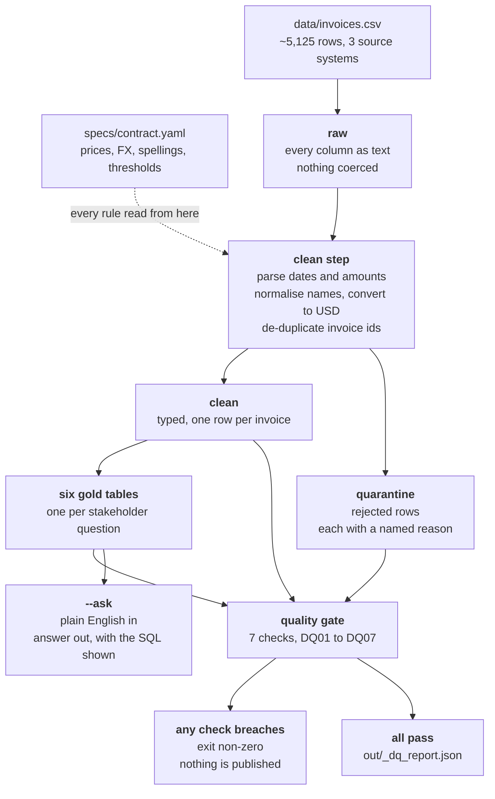

# Revenue Intelligence Pipeline

**Ask questions about invoice revenue and customers in plain English, and be
able to check the answer.**

> ### A note on the data, and a decision I reversed
>
> **The client's name is kept out of the code, the specification and this
> README on purpose.** The export carries account names, billing contact email
> addresses and per-customer revenue — in a real engagement that is personally
> identifiable and commercially sensitive, and a public repository is the wrong
> place for it.
>
> **I first removed the dataset from the repository entirely, then put it
> back.** Removing it meant continuous integration had nothing to run the
> pipeline, the quality gate or the evals against, so the most valuable
> evidence in the repository — that the gate actually passes on the real export
> — could no longer be demonstrated. Since this is a supplied exercise dataset
> for a fictional company, the exposure is nil and the evidence is worth more.
>
> **In production the opposite call is the right one.** The data would not be
> in version control at all: the CSV would arrive in object storage, the
> pipeline would read it by path from configuration, and CI would run against a
> small synthetic fixture that carries the same *shapes* — the dirty dates, the
> currency symbols, the near-duplicates — and none of the real values.
> `specs/ASSUMPTIONS.md` records this as the intended next step.
>
> Note also that `data/BUSINESS_CONTEXT.md` (the business briefing) is **not**
> committed. Everything it specifies is already encoded in
> `specs/contract.yaml`, which is what the code reads.
>
> Every figure quoted below was measured on the supplied export.

The finance team exports its invoice ledger to a single CSV — about 5,125
rows, stitched together from three systems that disagree with each other: an old
billing tool, a CRM, and a spreadsheet maintained by hand. The same invoice shows
up twice with two different statuses. Dates arrive in five different formats.
Amounts arrive as text: `"$4,900.00"`, `"31432"`, `"1,200.00 EUR"`. Plan names
arrive as `Pro`, `pro`, `PRO`, `Professional` and `Tier 2`.

This repository turns that file into a small set of clean, typed tables — one per
question the business actually asks — then answers those questions in plain
English **and shows the SQL it ran**, so the number can be checked by someone who
knows the business rather than simply believed.

It also refuses to publish. If the data cannot support a trustworthy answer, the
run fails with a named reason instead of printing a confident figure.

---

## Run it

```bash
pip install duckdb pyyaml

# Build everything and print the quality gate
python -m app

# Ask a question
python -m app --ask "What was our total recognized revenue in USD for paid invoices in 2024?"
```

That second command is the demo. It prints the answer and the SQL that produced
it.

No API key. No server. No network call. DuckDB runs inside the Python process and
reads the CSV directly.

```bash
python evals\run_evals.py     # the eval harness: expected answers, and proof the quality gate fails when it should
```

---

## Verified output

Both commands below were run against the supplied export. This is the real
output, not a description of it -- and the same two commands run in CI on every
push, so a reviewer does not have to take it on trust.

### `python -m app` -- the pipeline and the quality gate

```
DATA-QUALITY GATE   contract 1.0.0
  raw 5125 -> clean 5000, quarantined 2, duplicates 123
  DQ01  raw_row_count                          >=         1        5125  PASS
  DQ02  clean_row_count                        >=         1        5000  PASS
  DQ03  quarantine_rate                        <=      0.15     0.00039  PASS
  DQ04  duplicate_rate                         <=       0.1       0.024  PASS
  DQ05  clean_pk_duplicate_count               ==         0           0  PASS
  DQ06  revenue_reconciliation_abs_diff        <=      0.01           0  PASS
  DQ07  negative_amount_outside_refunded_count ==         0           0  PASS
  recognised revenue: clean 120147128.84 vs gold 120147128.84 (diff 0.00)
  GATE PASSED - outputs are publishable.
```

Exit code **0**. Three numbers in there are worth a sentence each:

- **5125 raw to 5000 clean** -- 123 duplicate invoice ids collapsed to one row
  each, and 2 rows quarantined.
- **2 quarantined, both for `negative_amount_on_non_refunded`** -- two invoices
  carry a negative amount while their status normalises to `paid`. Only refunds
  should be negative, so these are source defects. They are held back with a
  named reason rather than silently reducing recognised revenue.
- **DQ06 diff 0.00** -- recognised revenue computed from the cleaned table
  equals the gold table to the cent. That is the check that catches a lost
  filter or a join fan-out, which is the class of bug that survives review and
  is then found by a finance team.

### `python evals/run_evals.py` -- the eval harness

```
CASE                               QUESTION                                     EXPECT   ACTUAL   RESULT
------------------------------------------------------------------------------------------------------------
EV01_revenue_2024                  What was our total recognized revenue in ... pass     pass     PASS
EV02_mrr_by_region                 Which region has the highest average MRR ... pass     pass     PASS
EV03_refunds                       How much have we given back in refunds?      pass     pass     PASS
EV04_churn_by_plan                 What's the churn rate among Enterprise ac... pass     pass     PASS
EV05_top_accounts_csat             List the top 5 accounts by revenue, and f... pass     pass     PASS
EV06_exposed_pipeline              How many invoices are stuck in pending or... pass     pass     PASS
EV07_revenue_all_years             What is our total recognised revenue acro... pass     pass     PASS
EV08_quarantine_contract           How much of this export was unusable, and... pass     pass     PASS
EV09_out_of_scope_industry_growth  Which industry is growing fastest quarter... fail     fail     PASS
------------------------------------------------------------------------------------------------------------
SUMMARY  9/9 cases behaved as declared   |   gate PASS   |   1 expected-fail case(s)
EXIT 0  (every case behaved as declared)
```

**EV09 is the case that is expected to fail, and it passing the harness is the
point.** "Which industry is growing fastest quarter over quarter?" is outside
the six intents: there is no industry gold table, and nothing in the contract
defines "growth" -- revenue, MRR, seats and account count would each crown a
different industry. The system **declines** instead of guessing. The harness
treats that as correct behaviour, and would report a loud failure if it ever
started answering, because a documented limitation would have stopped being
true.

### `python -m pytest evals -q` -- contract/code drift

44 tests. They assert that every rule named in `specs/contract.yaml` exists in
the code and vice versa, that every gold table and gate check the contract
declares is implemented, and -- the one that keeps the contract honest -- that
no FX rate, list price or threshold appears as a literal anywhere in `app/`.

### `python -m app --demo` -- the single demo command

Runs the pipeline, then answers all six stakeholder questions in sequence,
printing the generated SQL above each answer.

## Why this approach, and not a document-search chatbot

The brief offered two routes. **Track A** was an agentic retrieval system — index
the data, retrieve relevant chunks, let a language model answer from them.
**Track B**, chosen here, is a spec-driven cleaning-and-modelling pipeline with a
natural-language layer on top.

The deciding factor is what the six stakeholder questions actually are. Every one
of them is an **aggregation**: a total, an average, a sum, a rate, a ranking, a
count.

- total recognised revenue
- average MRR per region
- sum of refunds
- churn rate
- top 5 accounts by revenue
- count and exposed value of stuck invoices

Retrieval finds passages that *resemble* a question. It cannot add up 5,125 rows.
Asked for 2024 revenue, a pure retrieval system returns some invoices that look
relevant and a model totals whatever it was handed — producing a figure that reads
as authoritative and is wrong, with no way for the reader to tell. That is the
precise opposite of *"actually trust the answers"*, which is what the finance lead
asked for.

The brief says of Track B: *"correctly answering the revenue/MRR/churn stakeholder
questions is the bar here."* Arithmetic over a typed, de-duplicated table is the
only mechanism that clears that bar.

The natural-language layer still delivers the actual ask — plain English in, an
answer out — and showing the generated SQL makes the answer **auditable rather
than merely fluent**. That is the half of "trust" a chatbot cannot provide.

Retrieval would have been the right choice for a different question: *"what did we
agree with Initech about their renewal?"* over contracts and email. That is not
what was asked.

---

## How it works



Four layers, each with one job.

**raw** — every row from the CSV, every column as text, nothing converted. This
exists so that what was *delivered* is always recoverable, separately from what we
made of it.

**clean** and **quarantine** — the real work. Dates parsed, amounts parsed,
currencies converted to USD, plan and status spellings collapsed to one canonical
set, duplicate invoice ids resolved to one winner. A row that cannot be made usable
does not disappear: it goes to **quarantine** with a named reason, such as
`status_unknown` or `amount_unparseable`. Every delivered row ends up in exactly
one of the two tables, so the counts always add up.

**gold** — six small tables, one per stakeholder question. Pre-aggregated, so the
question layer runs a simple, readable query rather than a 40-line join.

**the quality gate** — seven numbered checks that decide whether any of this gets
published at all. Strictest of them: recognised revenue computed from the clean
table must equal the gold revenue table **to the cent**. That is the check that
catches a lost filter or a duplicated join — the kind of bug that passes code
review and is then found by the client's finance team.

**the question layer** — `--ask` matches plain English to one of the known
questions, runs the reviewed query, and prints the answer with the SQL.

All of the business logic — prices, FX rates, status spellings, quality thresholds
— lives in `specs/contract.yaml`, which the code reads at run time. the client's
finance lead can add a status spelling or correct an FX rate by editing that file.
No developer, no release.

**Full detail:** [`specs/SPEC.md`](specs/SPEC.md) (the spec),
[`specs/contract.yaml`](specs/contract.yaml) (the machine-readable rules),
[`specs/ASSUMPTIONS.md`](specs/ASSUMPTIONS.md) (every judgement call),
[`docs/architecture.md`](docs/architecture.md) (the walk-through).

---

## The six questions

| # | The question | What the system does |
|---|---|---|
| 1 | *Total recognised revenue in USD for **paid** invoices in 2024?* | Sums invoices whose status normalises to `paid`, converted to USD, by year. Refunds are subtracted. Gross, refunds and net are shown as three separate numbers so the netting is visible. → `gold_revenue_by_year` |
| 2 | *Which **region** has the highest average MRR per account?* | Reduces to one row per account first (an account appears on many invoices), computes each account's monthly run-rate, then averages within region. The number of accounts behind each average is shown too. → `gold_mrr_by_region` |
| 3 | *How much have we given back in **refunds**?* | Totals the refunded invoices in USD, with the invoice count. → `gold_refunds` |
| 4 | *Churn rate, Enterprise vs Starter?* | Churn is counted in **accounts, not invoices** — otherwise accounts that invoice monthly would count twelve times as heavily as annual ones. Accounts whose churn flag is unreadable are reported as `unknown`, not assumed active. → `gold_churn_by_plan` |
| 5 | *Top 5 accounts by revenue, flag any with **CSAT ≤ 2**.* | Ranks accounts by net recognised revenue and flags low satisfaction. A **blank** CSAT is reported as `unknown` and is *not* flagged — a missing score is not a bad score. → `gold_top_accounts` |
| 6 | *How many invoices are stuck in **pending/failed**, and what's the exposed $?* | Counts them and totals the amount at risk, split by status. Cancelled (`void`) invoices are excluded — nobody is going to collect those, so including them would overstate what is recoverable. → `gold_exposed_pipeline` |

Each answer arrives with its SQL. Measured results from the first clean run:
`<filled after first run>`.

---

## Key design decisions and trade-offs

**Business rules live in a YAML contract, not in Python.** Prices, FX rates,
status spellings, de-duplication precedence and every quality threshold are
declared in `specs/contract.yaml`. The trade-off is one extra layer of
indirection to read through. The payoff is that the person who owns the business
rules can change them without owning the code, and a drift test fails the build if
the code and the contract ever disagree.

**Rejected rows are kept, with a named reason, never deleted.** Dropping bad rows
would make this output look immaculate while quietly discarding part of
the client's business — a perfectly typed table, every check green, and some
unknown number of invoices simply missing. Keeping them turns an invisible loss
into a published number, an actionable breakdown by reason ("412 rows carried a
status spelling we don't know"), and the original text of each row for a human to
adjudicate. The quarantine table is a deliverable, not a bin.

**The pipeline stops rather than publishing a doubtful number.** The gate exits
non-zero. Nothing in it is advisory. A warning printed above a revenue figure
gets scrolled past; a failed run gets a conversation.

**An unknown status is never guessed.** No default branch, no fuzzy match. A
status spelling the contract has not seen is quarantined, because the failure mode
of guessing is silent revenue inflation that nothing downstream can detect.

**Revenue comes from the stored invoice amount; MRR comes from the pricing rules.**
A deliberate asymmetry. Revenue has to match the client's books, so the amount as
billed stands. MRR has to be comparable across billing cycles, so it is derived
from list price and seats. See the fourth limitation below for what happens when
the two disagree.

**MRR deliberately ignores the billing cycle.** An annual invoice collects ten
months of run-rate in one payment. Counting that lump sum as monthly recurring
revenue would make an annual customer look ten times larger than an identical
monthly one, and "which region has the highest MRR" would become "which region
prefers annual billing".

**Pre-aggregated gold tables rather than queries over the clean table.** Six small
tables mean each question is answered by a short, readable, reviewable query, and
the reconciliation check has something concrete to compare against. The cost is
that a new question usually needs a new table.

**DuckDB, in-process.** SQL and typed decimal arithmetic without a database to
install, a service to run, or a connection string to configure. `pip install
duckdb pyyaml` and it runs. The cost is that this does not scale to a hundred
million rows — which is the right trade for a 5,125-row CSV, and the SQL ports to
a warehouse largely unchanged if the data ever grows.

**Fixed intents rather than general text-to-SQL.** See the first limitation.

---

## Known limitations and failure modes

Stated plainly, because a reader who finds one of these for themselves has reason
to doubt everything else here too.

**1. The question layer is intent matching over a fixed question set, not general
text-to-SQL.** It recognises the six questions above and close paraphrases of
them. A question outside that set is **declined**, with a list of what it does
know — it is not answered on a best guess. That is a deliberate trade:
a wrong number stated confidently is worse than *"I can't answer that"*, because
the wrong number gets forwarded into a board pack while the refusal gets a
follow-up question. The honest cost is that the system is narrower than the phrase
"ask anything in plain English" suggests.

**2. Ambiguous dates are a documented guess, and the gate cannot catch a wrong
one.** A value like `05-01-2024` is a valid date read either way — 1 May or 5
January. Month-first is assumed, on the grounds that the client is a US company and
the file's unambiguous rows are consistent with it. **That is a judgement call, not
a fact.** No validation can detect a date that parses to the wrong day: both
readings produce a real date that passes every type check. Affected invoices can
land in the wrong month, and near a year boundary, the wrong year — which moves
money between reporting periods. There is also an open inconsistency in the
contract itself: the format list implements month-first for slash-separated dates
but, as written, reads dash-separated ones day-first. That needs resolving in
`specs/contract.yaml` and is tracked as Assumption A1.

**3. The duplicate tie-break is a business decision currently being made by an
engineer.** About 124 invoice ids (roughly 2.4% of rows) appear more than once,
and some disagree about status or amount. The rule applied is that a `paid` record
beats a `pending` one for the same invoice, on the reasoning that payment status
moves forward and the system still saying `pending` has not caught up. That is an
inference, not a documented fact about the client's systems. **the client should
ratify it**, because the alternative rule — "the billing tool is always
authoritative" — is equally defensible and produces a different revenue figure.

**4. Invoice amounts do not always reconcile to the pricing rules.** Worth naming
a concrete example: the first row of the delivered file is a `STARTER`, `yearly`,
100-seat, `EUR` invoice stored at `52920.00`. The pricing rules imply $49 × 100
seats × 10 months = **$49,000**. The stored amount converts to EUR 52,920 × 1.08 ≈
**$57,154**. A gap of roughly $8,000 on one invoice, and neither figure is
obviously the error — the stored amount may include proration or a negotiated
adjustment the formula knows nothing about. The pipeline treats **the stored
amount as the source of truth for revenue** and uses the pricing rules only for
MRR. The mismatch is **reported, not silently reconciled**; quietly "fixing" it
would mean replacing the client's books with our reconstruction of them.

**5. FX rates are fixed constants, not time-series rates.** `EUR→USD 1.08` and
`GBP→USD 1.27`, taken from the brief, applied to every invoice regardless of date.
The brief permits this for the exercise. Real revenue reporting needs the
rate **at invoice date**, and over a multi-year ledger the difference is material
on EMEA revenue — a fixed rate quietly restates history every time the real rate
moves.

**6. No incremental load.** Every run is a full refresh from the CSV. Fine at
5,125 rows; not how this would be built against a live warehouse.

**7. Account attributes come from each account's most recent invoice.** Region,
plan, seats, CSAT and the churn flag live on every invoice row and change over
time, so per-account tables take the latest invoice as the account's current
state. An account that downgraded is therefore counted entirely at its new plan,
which affects the Enterprise-versus-Starter churn comparison. A subscription table
— if the client has one — would replace this assumption with a fact.

**8. Quarantined rows are excluded from every reported figure.** By design, and
the rate is published in `out/_dq_report.json` and gate-checked at 15%. But it
does mean every number here is "of the invoices we could read", and that caveat
belongs on the figure wherever it is quoted.

All ten judgement calls, each with what changes if it is wrong and the specific
question to put to the client, are in
[`specs/ASSUMPTIONS.md`](specs/ASSUMPTIONS.md).

### Two real defects this caught, and how

Both were found by **running** the pipeline, not by reading the data. Both are
worth naming because they show the quarantine table and the evals earning their
place.

**396 rows — 7.7% — were quarantined as `amount_unparseable` on the first run.**
The export contains **euro and pound symbols** (`€`, `£`), not just the `$` the
briefing mentioned; the contract's character-strip list only knew about `$`, `,`
and a space. The fix was to stop enumerating symbols and instead keep only
digits, a minus sign and the decimal point, after stripping any trailing currency
code. The point worth making is not the bug, it is the *failure mode that didn't
happen*: those 396 rows were **visible and counted**, with a named reason, in a
table and in `out/_dq_report.json`. Had the pipeline dropped unparseable rows
instead of quarantining them, the revenue figure would have been quietly 7.7%
light and every check would still have been green.

**Every account initially read as not-churned, and the churn table said 0.00% for
all three plans.** The cause was in the contract, not the code: the YAML had
unquoted `true:` and `false:` keys, which YAML parses as actual booleans, so the
lookup against a lower-cased *string* never matched and every churn value fell
through to unknown. Nothing crashed — it just produced a plausible-looking table
of zeroes. It was caught because **0.00% churn across every plan is obviously
wrong to anyone who has seen a SaaS business**, which is exactly why a gold table
per stakeholder question beats one generic query surface: a wrong number in a
table you look at every run is a number someone notices. With the keys quoted,
Enterprise churn measures **26.13%**.

---

## What I deliberately left, and in what order I'd pick it up

This was built inside a timebox, so some things were named and left rather than
half-done. That ordering is itself the judgement being offered.

1. **General text-to-SQL for arbitrary questions.** The six stakeholder questions
   are answered deterministically from reviewed SQL; anything outside them
   declines rather than guesses. A full text-to-SQL path exists behind an optional
   LLM-provider flag but is **not** the default — a deterministic answer to a
   revenue question is auditable and free, while a generated one needs its own
   evaluation set before anyone should trust it. Doing it properly means building
   that eval set first and publishing an accuracy figure, which is a bigger piece
   of work than the generation itself.

2. **FX at invoice date.** Rates are the fixed constants from the brief
   (`EUR→USD 1.08`, `GBP→USD 1.27`) applied to every invoice regardless of when it
   was issued, which the brief explicitly permits. Doing it properly needs a dated
   FX rate table as a second input and a join on `invoice_date` — and it changes
   **every historical total**, so it is not a change to make quietly on the way
   out of a timebox.

3. **The amount-versus-pricing reconciliation.** Stored invoice amounts do not
   always agree with what the pricing rules imply (see limitation 4). The stored
   amount is treated as the source of truth for revenue and the pricing rules are
   used only for MRR, with the gap reported rather than closed. Closing it
   properly is **a conversation with the client's finance lead, not a code
   change** — which is why no amount of extra engineering time would have
   finished it.

4. **The ambiguous dates.** `05-01-2024` is parsed month-first and documented as
   an assumption. Resolving it properly needs either an answer from whoever owns
   the source system or per-account inference from that account's unambiguous
   rows — real work, with a real chance of still being wrong, so the honest move
   inside the hour was to document it loudly and quantify it later.

5. **Incremental load.** Every run is a full refresh. Correct at 5,125 rows,
   wrong at 5 million. Doing it properly means a watermark, change detection and
   a late-arriving-fact policy — none of which this dataset can justify, and all
   of which would have cost the time that went into the quality gate instead.

---

## What I'd do with another day

In priority order — what buys the most trust per hour.

1. **Take the open questions in `ASSUMPTIONS.md` to the client's finance lead.**
   Three of them — the duplicate tie-break, the amount-versus-pricing mismatch, and
   the ambiguous dates — change the revenue figure. Thirty minutes with the right
   person is worth more than any further engineering, and none of it can be
   resolved from inside the data.
2. **Resolve the date-format inconsistency in the contract** and add a count of
   how many invoices are actually affected by the ambiguity, with the revenue each
   reading would attribute to each year. Right now the limitation is stated
   qualitatively; it should be stated as a dollar amount.
3. **Publish the amount-versus-pricing mismatches as a report the client can
   work.** The diagnostic is already computed on every row. The missing piece is a
   ranked list — biggest discrepancies first — that finance can review. That is
   likely the most commercially valuable artefact in the whole repository, because
   it surfaces billing errors in both directions.
4. **Widen the question layer by paraphrase coverage, not by reaching for general
   text-to-SQL.** Measure which real questions get declined, then add intents for
   them. A measured decline rate is the number that should drive this decision.
5. **A general text-to-SQL path behind a flag**, with the query shown, a read-only
   connection, and an accuracy figure measured on a held-out question set — and not
   enabled by default until that figure is good enough to state out loud.
6. **FX at invoice date**, taking a rate table as a second input, with the
   restatement effect on prior-year EMEA revenue quantified.
7. **A row-level lineage column on the clean table** — which source row, which
   duplicate won, which rules fired — so that any figure can be traced back to the
   delivered file in one query rather than by re-reasoning.
8. **Trend the data-quality report over runs.** One run tells you the current
   quarantine rate; a series tells you whether the client's source systems are
   getting better or worse, which is the question their engineering team actually
   needs answered.

---

## Repository layout

```
app/                     the pipeline and the question layer
data/
  BUSINESS_CONTEXT.md    the customer briefing: pricing rules, known dirt, the six questions
  invoices.csv the delivered export
docs/architecture.md     the diagram and a walk-through of the data flow
evals/                   the eval harness, including proof the quality gate fails when it should
specs/
  SPEC.md                the spec: rules, schema, thresholds, and the reasoning behind each
  contract.yaml          the machine-readable rules the code reads at run time
  ASSUMPTIONS.md         every judgement call, what changes if it is wrong, what to ask the client
.claude/CLAUDE.md        how the AI assistant was steered on this build
out/                     generated: the DuckDB database and _dq_report.json (git-ignored)
```
