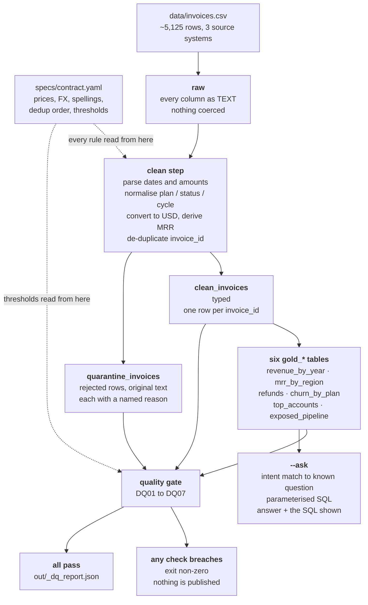

# Architecture

How a dirty CSV becomes a number somebody can check.

The engine is **DuckDB**, running in-process inside Python. There is no server to
start, no connection string, and no network call on the default path — DuckDB
reads `data/invoices.csv` directly and does the typed decimal
arithmetic in the same process. Setup is `pip install duckdb pyyaml`.



---

## The flow, layer by layer

### 1. `raw` — what was delivered

Every row, every column, as **text**. Nothing is converted on the way in.

That is deliberate. A CSV reader that tries to type `"$4,900.00"` as a number
either errors on the whole file or nulls the cell, and in both cases the evidence
of what was actually delivered is gone. Keeping an untouched text layer means the
question "did we lose this invoice, or did it never arrive?" is always answerable
by looking.

### 2. `clean` + `quarantine` — the real work, and the fork

One step, two outputs. In order: trim and lower-case for lookup → normalise
categories → parse dates → parse amounts → convert currency and derive MRR →
quarantine the unusable → de-duplicate.

**`clean_invoices`** is typed, canonical, and exactly **one row per
`invoice_id`**. Plan and status spellings have collapsed to one set, amounts are
`DECIMAL` in USD, dates are real dates, and the 124-odd duplicated invoice ids
have been resolved to a single winner by status precedence (`paid` beats
`pending`), then later date, then larger absolute amount.

**`quarantine_invoices`** holds every row that could not be made usable, **in its
original text**, each with a named reason: `status_unknown`,
`amount_unparseable`, `invoice_date_unparseable`, `seats_not_positive`,
`currency_unknown`, and so on. Nothing is deleted and nothing is bucketed as
"other".

The invariant that makes the whole pipeline checkable: **every raw row lands in
exactly one of these two tables.** `raw = clean + quarantine`, always. A row
cannot quietly disappear between them.

Why the fork rather than a filter: dropping bad rows would make the output look
immaculate while silently discarding part of the client's business. The quarantine
table converts an invisible loss into a published count, an actionable breakdown
by reason, and the original text for a human to adjudicate.

Ordering note: normalisation runs **before** quarantine, so a row is only ever
rejected for being genuinely unusable rather than for being capitalised oddly.
De-duplication runs **last**, so the tie-break compares canonical statuses rather
than raw spellings.

### 3. `gold_*` — one table per question

Six small pre-aggregated tables, one for each stakeholder question:

| Table | Question |
|---|---|
| `gold_revenue_by_year` | Total recognised revenue in USD for paid invoices, by year |
| `gold_mrr_by_region` | Which region has the highest average MRR per account |
| `gold_refunds` | How much has been given back in refunds |
| `gold_churn_by_plan` | Churn rate by plan, Enterprise vs Starter |
| `gold_top_accounts` | Top accounts by revenue, flagged where CSAT ≤ 2 |
| `gold_exposed_pipeline` | Invoices stuck in pending/failed, and the exposed dollar value |

Three of these report **per account**, not per invoice — MRR by region, churn by
plan, and top accounts. Region, plan, seats, CSAT and the churn flag are account
attributes carried on every one of that account's invoice rows, so those tables
reduce to one row per account first (taking the account's latest invoice as its
current state) before aggregating. Skipping that reduction would weight each
account by how often it happened to be billed.

Pre-aggregating buys two things: each question is answered by a short, readable,
reviewable query, and the reconciliation check has a concrete artefact to compare
against. The cost is that a genuinely new question usually needs a new table.

### 4. The quality gate — the publish decision

Seven numbered checks, thresholds from the contract, run on **every** invocation.
Results go to `out/_dq_report.json` with a pass/fail line printed per check.

| ID | What it protects |
|---|---|
| DQ01 | The export is not empty — a zero-byte file must not report "$0 revenue" |
| DQ02 | Not everything was quarantined — that means the schema changed upstream |
| DQ03 | Quarantine rate within 15% — above that the export itself is suspect |
| DQ04 | Duplicate rate within 10% — a jump signals an overlapping extract window |
| DQ05 | Zero duplicate keys in the clean table — a duplicated key double-counts money |
| DQ06 | Revenue reconciles clean-to-gold **to the cent** — catches a lost filter or a join fan-out |
| DQ07 | No negative amount outside `refunded` — that is a source defect, not a discount |

**If any check breaches, the process exits non-zero.** Nothing here is advisory,
because a warning printed above a revenue figure gets scrolled past while a failed
run gets a conversation.

The gate is also tested in the direction that matters: the eval suite feeds
deliberately broken input and asserts each specific check **fails**. A gate only
ever observed passing is not evidence of anything.

### 5. `--ask` — the natural-language layer

```bash
python -m app --ask "What was our total recognized revenue in USD for paid invoices in 2024?"
```

The question text is matched to one of a fixed set of known intents — the six
above and close paraphrases. The matched intent runs its reviewed, **parameterised**
query against the gold tables, and the answer is printed **together with the SQL
that produced it**.

Two properties are load-bearing:

- **The SQL is always shown.** Trust comes from a number somebody who knows the
  business can check, not from fluent phrasing.
- **An unrecognised question is declined**, with a list of what the system does
  know. It is never answered on a best guess. A confidently wrong number gets
  forwarded into a board pack; a refusal gets a follow-up question.

This is intent matching, not general text-to-SQL. That boundary is a deliberate
trade and is stated as a limitation in the README rather than glossed over.

---

## The contract, running alongside everything

`specs/contract.yaml` is not configuration in the usual sense — it is the business
logic. Prices, FX rates, every accepted status and plan spelling, the date format
order, the de-duplication precedence, the quarantine tests and all seven gate
thresholds are read from it at run time. Nothing business-related is a literal in
a Python file, and `evals/test_contract_drift.py` fails the build if the code and
the contract ever disagree.

What that buys commercially: the client's finance lead can add a status spelling,
correct an FX rate, or loosen a quality threshold by editing one YAML file — no
developer, no release.

The prose version of the same rules, with the reasoning behind each value, is
[`specs/SPEC.md`](../specs/SPEC.md). The judgement calls the data could not
settle are in [`specs/ASSUMPTIONS.md`](../specs/ASSUMPTIONS.md).
